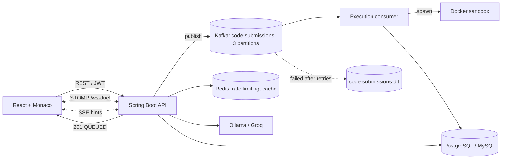

# CodingFriend: AI Coding Mentor & Real-Time Judge

<p align="center">
  <a href="https://coding-friend-kappa.vercel.app">
    
  </a>
</p>

[](https://openjdk.org/projects/jdk/17/)
[](https://spring.io/projects/spring-boot)
[](https://kafka.apache.org/)
[](https://react.dev/)
[](https://www.typescriptlang.org/)

An online judge for Java where an AI mentor analyzes your mistakes and gives **progressive Socratic hints** instead of handing you the solution. Untrusted code runs in locked-down Docker sandboxes, and grading is decoupled from the API through Kafka.

**Live demo:** [coding-friend-kappa.vercel.app](https://coding-friend-kappa.vercel.app) (frontend)

---

## Highlights

| Area | What it does |
|---|---|
| **Async grading** | `POST /submissions` returns HTTP `201 QUEUED` immediately. Kafka workers grade in the background, so web threads are never blocked by code execution. |
| **Sandboxed execution** | Every run gets an ephemeral Docker container: no network, 256 MB RAM, 64 PIDs, read-only filesystem, `noexec` tmpfs, non-root user, hard timeout. |
| **Socratic AI mentor** | 4 hint tiers, streamed over SSE, from a local Ollama model or Groq. A rule-based classifier diagnoses common failure types before the LLM is called. |
| **Real-time duels** | 1v1 algorithm duels over a STOMP WebSocket broker with live opponent progress and Elo-style rating. |
| **Learning engine** | Step-through debugger with visualizers, AI post-mortems, SM-2 spaced repetition. |
| **Tested** | 244+ backend unit, integration and Testcontainers tests. |

 

## Architecture



**Submission lifecycle**

1. Client submits code. `SubmissionServiceImpl` persists it as `QUEUED` and `KafkaSubmissionEventProducer` publishes an event to `code-submissions`.
2. The API responds `201` right away. The client follows grading state live.
3. `SubmissionExecutionConsumer` picks the event up, **checks idempotency** so a redelivered message never runs twice, and runs the code through `DockerJavaExecutor`.
4. Results are persisted. Messages that keep failing go to the dead-letter topic `code-submissions-dlt`.

---

## Features

### 1. Sandboxed code execution

Untrusted code never runs inside the application JVM. `DockerJavaExecutor` starts a fresh container from `eclipse-temurin:17-jdk-alpine` for each run:

| Control | Setting | Protects against |
|---|---|---|
| Network | `--network none` | Data exfiltration, outbound calls |
| Memory | `--memory 256m` | Memory bombs |
| CPU | 1 core quota | CPU starvation |
| Processes | `--pids-limit 64` | Fork bombs |
| Filesystem | `--read-only` | Tampering with the image |
| Scratch space | `--tmpfs /tmp:rw,noexec,nosuid,size=32m` | Dropping and executing binaries |
| User | `1001:1001` (non-root) | Privilege escalation |
| Time | 5 s hard timeout | Infinite loops |

Output is read through a bounded asynchronous stream reader (`StreamCapture`) that truncates stdout/stderr, preventing log-bombing and pipe deadlocks. Hidden grading tests stay on the server; only sample cases are exposed to clients.

### 2. Progressive Socratic AI mentorship

- **4 hint tiers:** Gentle Nudge, Conceptual Insight, Algorithmic Blueprint, Targeted Pointer. Each tier reveals more without giving away the code.
- **Mistake engine:** a rule-based AST/regex classifier diagnoses NullPointerException, IndexOutOfBounds, infinite loops and StackOverflow, and categorizes syntax, logic, runtime and TLE failures (`MistakeAnalyzerImpl`).
- **SocraBuddy:** `SocraBuddyMentorServiceImpl` streams LLM responses to the browser with `SseEmitter`.
- **Model choice:** run fully local with Ollama (`qwen2.5-coder`, `deepseek-coder`, `llama3`) with no API key, or point it at Groq.

### 3. Real-time 1v1 duels

- Matchmaking queue and a live duel state machine over a Spring WebSocket STOMP broker (`/ws-duel`, configured in `WebSocketConfig`).
- Opponent progress (test cases passed, submission state) and a shared timer update live.
- Elo-style rating adjustment and a post-duel breakdown.
- Submission and hint endpoints are protected by a Redis-backed rate limiter (`RateLimiterService`).

### 4. Step debugger and visualizers

- Line-by-line stepping (forward, back, auto-play) synchronized with Monaco Editor highlights.
- Visualizers for arrays and pointers, hash maps/sets, DP tables, binary trees and graphs (BFS/DFS).
- Call stack and variable watch, plus Socratic checkpoints at key decision points.

### 5. Contests and spaced repetition

- Timed multi-problem contests with an ICPC-style leaderboard (solved count plus penalty minutes).
- AI post-mortems for failed submissions: failing input, expected vs actual output, and execution-trace contrast.
- Personal revision notebook with an **SM-2 spaced repetition** scheduler (`Due for Review`, `To Revise`, `Mastered`), a mistake taxonomy, and a concept mastery radar.
- Big-O complexity estimation with detour warnings when a solution is far from optimal.

### 6. Security

- Spring Security with stateless JWT access tokens and database-backed **refresh-token rotation and revocation**.
- Google OAuth 2.0 (Google Identity Services) with server-side ID token verification and automatic user provisioning.
- BCrypt password hashing and role-based access control (`ROLE_USER`, `ROLE_LEARNER`, `ROLE_ADMIN`).
- Admin suite for problem CRUD, test case authoring, support tickets and moderation.

---

## Tech Stack

| Layer | Technology |
|---|---|
| Backend | Java 17, Spring Boot 3.3, Spring Security, Spring Data JPA, HikariCP |
| Messaging | Apache Kafka (KRaft, no ZooKeeper), dead-letter topic |
| Data | PostgreSQL 16 (also supports MySQL), Flyway migrations, Redis |
| Real-time | WebSocket (STOMP), Server-Sent Events |
| AI | Ollama (local) or Groq |
| Sandbox | Docker (`eclipse-temurin:17-jdk-alpine`) |
| Frontend | React 18, TypeScript, Vite, Monaco Editor, React Router |
| Testing | JUnit 5, Mockito, Testcontainers, Vitest |
| CI / API docs | GitHub Actions, Springdoc OpenAPI (Swagger UI) |

### Modular monolith layout

The backend is one deployable with strict module boundaries: `auth`, `user`, `problem`, `submission`, `execution`, `mentor`, `mistake`, `learning`.

```
CodingFriend/
├── backend/            # Spring Boot modular monolith (+ unit, integration, Testcontainers tests)
├── frontend/           # React + Vite + TypeScript app
├── code-executor/      # Sandbox runner Dockerfile and worker specs
├── docs/               # Architecture, API, security, testing docs and ADRs
├── .github/workflows/  # CI for backend and frontend
└── docker-compose.yml  # Local multi-container environment
```

---

## Quick Start

**Prerequisites:** Java 17+, Node.js 18+, Docker and Docker Compose. Ollama is optional (`ollama run qwen2.5-coder`).

```bash
# 1. Configure environment
cp .env.example .env

# 2. Start everything (Postgres, Redis, Kafka, Ollama, Code-Executor, Backend, Frontend)
docker compose up -d

# Or start only the infrastructure and run the apps on your host
docker compose up -d postgres redis kafka ollama

# 3. Backend (host mode)
cd backend && ./mvnw spring-boot:run

# 4. Frontend (host mode)
cd frontend && npm install && npm run dev
```

| Service | URL |
|---|---|
| Web app | http://localhost:5173 |
| API | http://localhost:8080 |
| Swagger UI | http://localhost:8080/swagger-ui.html |
| Health | http://localhost:8080/actuator/health |

---

## Testing

```bash
cd backend
./mvnw test                                          # full suite (244+ tests)
./mvnw test -Dtest=SecurityIntegrationTest,AuthControllerTest,JwtTokenProviderTest
./mvnw test -Dtest="*Kafka*,*Consumer*,*Producer*"   # messaging pipeline
./mvnw test -Dtest="*Execution*,*Evaluator*,*Executor*"  # sandbox
./mvnw test -Dtest="*Mentor*,*Mistake*,*Prompt*"     # AI and mistake engine

cd ../frontend
npm run test && npm run build
```

<!--
LOAD TESTING: uncomment ONLY after running the k6 tests and replacing every value with your real result.

## Load Testing

Tested on: <CPU cores, RAM, OS>, k6 <version>, local Docker.

| Metric | Result |
|---|---|
| Peak submission rate sustained | <value> |
| p95 intake latency | <value> |
| p95 end-to-end grading time | <value> |
| Error rate | <value> |

Scripts and raw results: docs/load-testing.md
-->

---

## Deployment

The frontend deploys as a static Vite build on Vercel (set root directory to `frontend` and `VITE_API_BASE_URL` to your backend URL; the SPA rewrite is preconfigured in `frontend/vercel.json`). The backend runs as a container alongside Postgres, Redis and Kafka. See [docs/deployment.md](docs/deployment.md).

---

## Documentation

[Architecture](docs/architecture.md) · [Requirements](docs/requirements.md) · [Database design](docs/database-design.md) · [API](docs/api-documentation.md) · [AI mentor](docs/ai-mentor.md) · [Code execution](docs/code-execution.md) · [Security audit](docs/security-audit.md) · [Testing](docs/testing.md) · [Observability](docs/observability.md) · [Dev setup](docs/development-setup.md) · [ADRs](docs/decisions/) · [Roadmap](docs/future-roadmap.md)

---

## Author

**Shiv Kumar Thakur** ([@shivkumar9693](https://github.com/shivkumar9693))

## License

Copyright (c) Shiv Kumar Thakur. All rights reserved. The source is published for review and evaluation; copying, redistribution or commercial use requires written permission. See [LICENSE](LICENSE) and [COPYRIGHT.md](COPYRIGHT.md).
