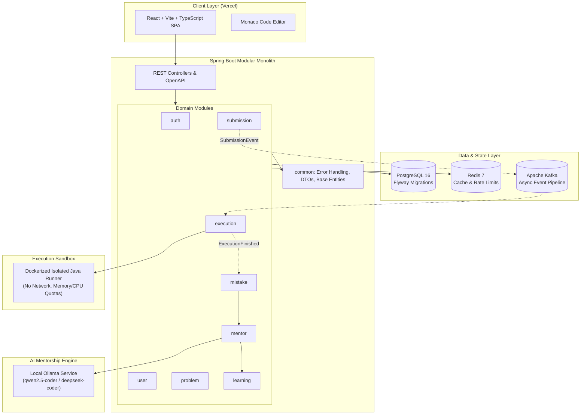

# Architecture Overview

## 1. Architectural Philosophy

**AI Coding Mentor** is designed as a **Modular Monolith** running within a single Spring Boot application runtime for its core domain services, while delegating untrusted code execution to isolated sandbox containers and AI inference to local/self-hosted LLM engines.

### Why Modular Monolith?
- **Domain Cohesion**: Enables rapid evolution of business concepts without the operational overhead, network latency, distributed transactions, and deployment complexity of microservices.
- **Strict Boundaries**: Domain logic is partitioned into clean, decoupled Java packages with explicit public APIs, preventing spaghetti code.
- **Evolutionary Path**: As submission volume or processing load grows, asynchronous boundaries (via Kafka) allow seamless extraction of the execution worker or AI mentorship into dedicated autonomous services without rewriting business rules.

---

## 2. High-Level System Topology

---

## 3. Implementation Status: Current Baseline (Day 1) vs Planned Components

| Component / Subsystem | Current Status | Description |
|---|---|---|
| **Project Foundation** | `Implemented` | Multi-module workspace structure (`backend/`, `frontend/`, `code-executor/`, `docs/`, `.github/`). |
| **Backend Modular Monolith** | `Implemented` | Spring Boot 3.3.4 (Java 17) package hierarchy (`auth`, `user`, `problem`, `submission`, `execution`, `mistake`, `mentor`, `learning`, `common`). |
| **Environment & Profiles** | `Implemented` | `application.yml`, `application-local.yml`, `application-test.yml`, `application-prod.yml` with 100% environment variable overrides. |
| **Health API & Diagnostics** | `Implemented` | Structured `/api/v1/health` endpoint and `/actuator/health` integration with uniform `ApiResponse<T>`. |
| **Global Error Handling** | `Implemented` | Central `@RestControllerAdvice` mapping domain exceptions to standard RFC-compliant `ErrorResponse` payloads. |
| **Database Schema V1** | `Implemented` | Flyway SQL migration (`V1__initial_schema.sql`) for users, problems, test cases, submissions, mistake reports, mentor chats, and hints. |
| **Frontend Web App** | `Implemented` | React 18 + Vite + TypeScript SPA with React Router, responsive dark layout, and automated Vitest suite. |
| **Sandbox Definition** | `Implemented` | Alpine + Eclipse Temurin 17 Dockerfile running unprivileged (`UID 1001`) with restricted entrypoint. |
| **Docker Compose Topology** | `Implemented` | Multi-container stack definition for Postgres 16, Redis 7, Ollama, Backend, and Frontend. |
| **CI Automation** | `Implemented` | GitHub Actions workflow verifying backend Java compilation/tests and frontend TypeScript build. |
| **Authentication Module** | `Planned` | JWT filter chain, user registration/login endpoints, BCrypt hashing *(Next Milestone)*. |
| **Problem Management** | `Planned` | Problem listing, detail endpoints, and seed datasets *(Planned)*. |
| **Isolated Execution Engine**| `Planned` | Dynamic Docker container spawning, test wrapper runner, and execution timeout watchdog *(Planned)*. |
| **Mistake Classifier** | `Planned` | AST/compiler error and stack trace diagnostics engine *(Planned)*. |
| **Socratic AI Mentor** | `Planned` | 4-tier progressive prompt generator and Ollama client integration *(Planned)*. |
| **Monaco Code Editor** | `Planned` | In-browser Java editor with live syntax highlighting and execution triggers *(Planned)*. |

---

## 4. Backend Module Specifications

All domain modules reside under `com.aicodingmentor`:

| Module | Core Responsibility | Key Concepts / Boundaries |
|---|---|---|
| **`common`** | Shared cross-cutting concerns | `ApiResponse<T>`, `ErrorResponse`, `GlobalExceptionHandler`, base auditing entities. No domain logic. |
| **`auth`** | Identity, authentication, token management | JWT issuance, password hashing with BCrypt, security filter chain. |
| **`user`** | User profile and statistics | User accounts, preferences, solved problems counter, mastery metrics. |
| **`problem`** | Problem catalog and test suites | Problem descriptions, starter templates, difficulty, public sample tests, hidden test cases. |
| **`submission`** | Code submissions lifecycle | Receives learner code, persists submission records, assigns status (`PENDING`, `RUNNING`, `EVALUATED`, `ERROR`). |
| **`execution`** | Code execution orchestration | Packages user code with test runners, dispatches to sandboxed runners, collects output and execution metrics. |
| **`mistake`** | Error & failure diagnostics | Classifies failures: Syntax Error, Runtime Exception, Logic Mismatch (assertion failure), Time Limit Exceeded (TLE). |
| **`mentor`** | Progressive Socratic hints | Manages hint state progression, formats prompts for Ollama, validates structured LLM hints, prevents solution leakage. |
| **`learning`** | Educational progression & retention | Tracks learner problem-solving history, hint usage patterns, cognitive concept mastery. |

---

## 5. Communication & Coupling Rules

1. **In-Process Module Interactions**:
   - Modules interact primarily via high-level Spring services or domain event publishers (`ApplicationEventPublisher`).
   - Modules MUST NOT query or join another module's JPA repositories directly.
2. **Asynchronous Processing Pipeline**:
   - Long-running operations (sandboxed compilation, test execution, LLM hint synthesis) are queued via asynchronous workers or Kafka topics to ensure sub-100ms HTTP response times for submission intake.
3. **No Direct Host Execution**:
   - The Spring Boot application NEVER invokes `Runtime.getRuntime().exec("javac ...")` or `ProcessBuilder` on the host machine. All execution is isolated inside dedicated worker containers.

---

## 6. Technology Standards

- **Java 17 / Spring Boot 3.3.x**: Leverages modern Java language features (records, pattern matching, sealed interfaces).
- **PostgreSQL 16**: Relational storage for problems, users, submissions, and structured test metadata.
- **Flyway**: Versioned, reproducible SQL schema migrations.
- **Redis 7**: Fast cache for problem metadata, rate limiting, and session tokens.
- **Ollama**: Open-source, local AI inference runtime communicating over HTTP REST.
