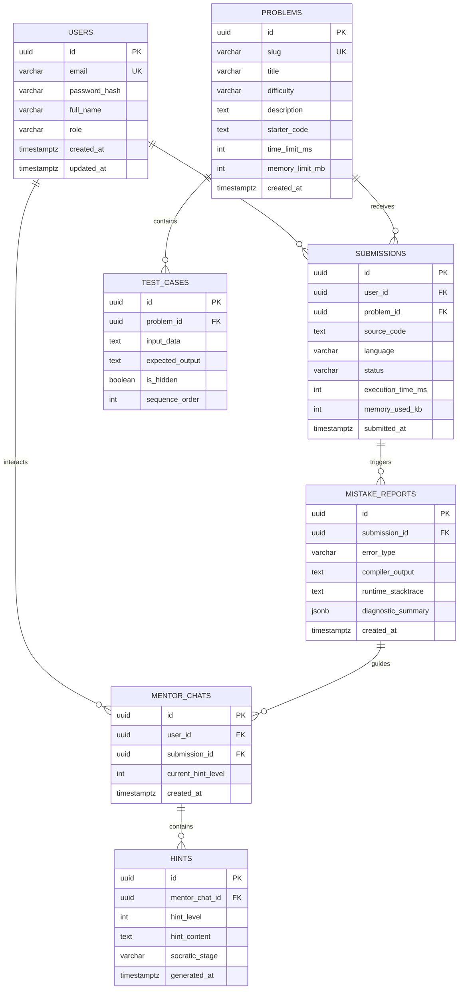

# Database Design & Architecture Specification

## 1. Executive Overview

**AI Coding Mentor** utilizes **PostgreSQL 16+** as its primary relational database management system, managed with version-controlled, automated schema migrations via **Flyway** and object-relational mapping via **Spring Data JPA / Hibernate**.

---

## 2. Architectural Database Decisions

### 2.1 Database Choice: PostgreSQL 16+
- **ACID Compliance & Reliability**: Robust transactional guarantees for critical paths (user submissions, grading state transitions, user progress tracking).
- **Semi-Structured Diagnostics (JSONB)**: Native high-performance `JSONB` support allows structured compiler diagnostics, AST analysis outputs, and LLM mentor metadata to be stored and indexed alongside relational records.
- **Native UUID Generation**: Efficient built-in `gen_random_uuid()` function minimizes round-trips and simplifies primary key creation.
- **Modern Concurrency Control**: Multiversion Concurrency Control (MVCC) and rock-solid connection pooling via HikariCP.

### 2.2 Primary Key Strategy: UUID vs Numeric IDs
We chose **128-bit UUIDs (v4)** as the standard primary key format across all entities:
- **Security & Anti-Enumeration**: Numeric auto-incrementing IDs (`BIGSERIAL`) expose sequential business data (e.g., total user count, total submissions) and allow malicious scraping/enumeration. UUIDs prevent ID guessing attacks.
- **Client & Offline Generation**: UUIDs can be generated on client or application layer if needed before persistence without central lock contention.
- **Distributed Safety**: Allows seamless extraction of modules into independent microservices or distributed shards in the future without ID collision risks.
- **Storage Efficiency**: Stored natively in PostgreSQL as 16-byte binary structures with high-efficiency B-Tree index traversal.

### 2.3 Timestamp Strategy
- **Standard**: All timestamp fields use `TIMESTAMPTZ` (`TIMESTAMP WITH TIME ZONE`).
- **Timezone Normalization**: All timestamps are persisted and handled in **UTC** across backend JVM, database, and client communication.
- **Auditing Columns**:
  - `created_at`: `TIMESTAMPTZ NOT NULL DEFAULT NOW()`, immutable once created.
  - `updated_at`: `TIMESTAMPTZ NOT NULL DEFAULT NOW()`, maintained via JPA lifecycle hooks (`@PreUpdate`) and database defaults.
- **Rationale**: Eliminates ambiguity during Daylight Saving Time (DST) changes, cross-timezone learner sessions, and server migrations.

### 2.4 Naming Conventions
- **Tables**: Plural `snake_case` (e.g., `users`, `problems`, `test_cases`, `submissions`, `mistake_reports`).
- **Columns**: `snake_case` (e.g., `password_hash`, `time_limit_ms`, `created_at`).
- **Primary Keys**: `id` (UUID).
- **Foreign Keys**: `<referenced_table_singular>_id` (e.g., `user_id`, `problem_id`, `submission_id`).
- **Indexes**: `idx_<table_name>_<column_name(s)>` (e.g., `idx_users_email`, `idx_problems_slug`).
- **SQL Keywords**: Uppercase (e.g., `CREATE TABLE`, `NOT NULL`, `PRIMARY KEY`, `DEFAULT`).

### 2.5 Migration Strategy: Flyway
- **Location**: `backend/src/main/resources/db/migration/`
- **Naming Pattern**: `V{VERSION}__{DESCRIPTION}.sql` (e.g., `V1__initial_schema.sql`).
- **Immutability**: Applied migration scripts are strictly immutable; once merged and applied, modifications must be introduced via new forward migrations.
- **Startup Lifecycle**: Flyway automatically executes upon Spring Boot startup before Hibernate schema validation (`hibernate.ddl-auto=validate`), ensuring zero schema drift between code and persistence.
- **Environments**:
  - `local`: Automated Flyway migration against local PostgreSQL instance.
  - `test`: Automated Flyway migration against ephemeral Testcontainers PostgreSQL instance during integration tests.
  - `prod`: Automated Flyway migration with baseline validation and read-only schema checks.

### 2.6 Indexing Strategy
- **Primary Keys**: B-Tree index created automatically on `id`.
- **Unique Lookups**: Unique B-Tree indexes on natural keys (`users.email`, `problems.slug`).
- **Foreign Keys**: Explicit indexes on all FK columns (`problem_id`, `user_id`, `submission_id`) to accelerate `JOIN` queries and cascaded operations.
- **Search & Filter Columns**: Selective indexing on high-cardinality filter fields (`problems.difficulty`, `submissions.status`).

---

## 3. Entity-Relationship Model (Conceptual Architecture)



---

## 4. Current Schema (Day 2 Baseline)

### `V1__initial_schema.sql` (Users and Roles Foundation)
Represents the core user foundation required for identity and role management:

```sql
CREATE TABLE IF NOT EXISTS users (
    id UUID PRIMARY KEY DEFAULT gen_random_uuid(),
    email VARCHAR(255) NOT NULL UNIQUE,
    password_hash VARCHAR(255) NOT NULL,
    full_name VARCHAR(150) NOT NULL,
    role VARCHAR(50) NOT NULL DEFAULT 'LEARNER',
    created_at TIMESTAMPTZ NOT NULL DEFAULT NOW(),
    updated_at TIMESTAMPTZ NOT NULL DEFAULT NOW()
);

CREATE INDEX IF NOT EXISTS idx_users_email ON users(email);
CREATE INDEX IF NOT EXISTS idx_users_role ON users(role);
```

---

## 5. Planned Schema Migrations (Subsequent Days)

| Version | Target Milestone | Description | Tables Included |
|---|---|---|---|
| **V1** | Day 2 (Current) | Users & Role Foundation | `users` |
| **V2** | Day 3 | Problem Catalog & Test Suites | `problems`, `test_cases` |
| **V3** | Day 4 | Submissions & Execution Tracking | `submissions` |
| **V4** | Day 5 | Mistake Diagnostic Engine | `mistake_reports` |
| **V5** | Day 6 | Socratic Mentor Chat & Hints | `mentor_chats`, `hints` |
| **V6** | Day 7 | Learning Mastery & Spaced Progress | `learner_mastery`, `concept_tags` |
